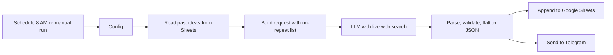

# AI Content Radar

An autonomous research agent that turns the daily AI news cycle into publish-ready content ideas for an Arabic-speaking Instagram audience.

## Flow

## What it produces

Ten ranked ideas per run, each with a hook, script or carousel outline, visual direction, tools needed, difficulty, caption and CTA, an appeal score with rationale, and a list of claims to verify. Every text field is also delivered in natural Arabic.

## Mix per run

- 3 news-driven discoveries
- 3 practical or mind-blowing demos
- 2 original experiments
- 2 unconventional ideas

## Design notes

- **No repeats**: previously generated titles are read from the sheet and excluded.
- **No fabricated news**: if research does not support strong news ideas, they are replaced with original concepts.
- **Strict JSON contract**: the parser fails loudly on malformed output instead of writing bad rows.
- **Delivered where it is used**: ideas land in a sheet for planning and in Telegram for quick review.
