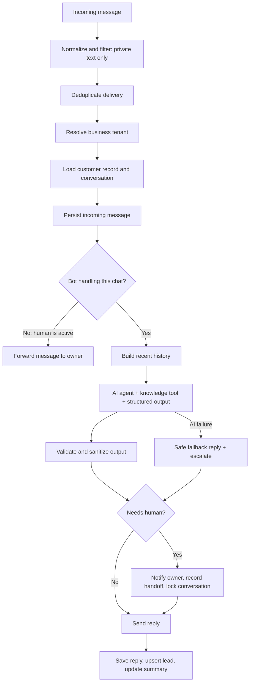
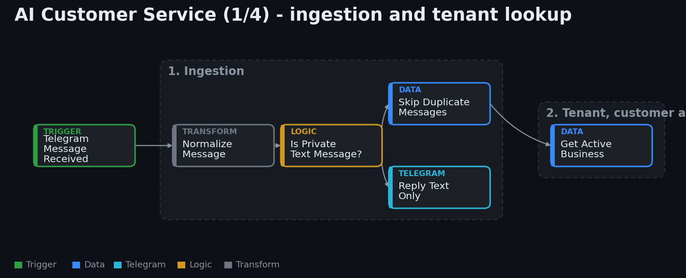
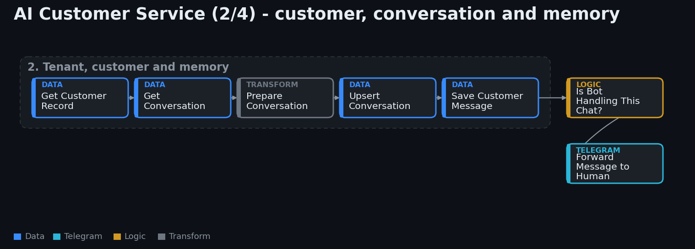
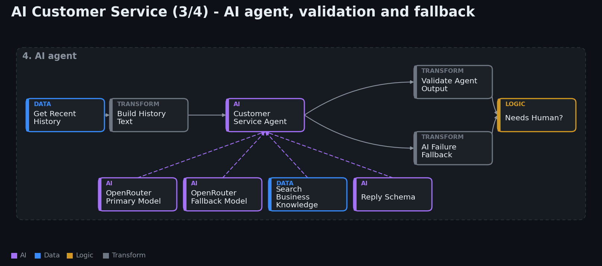
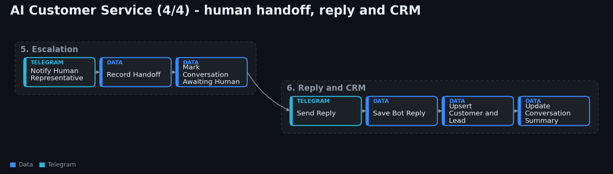
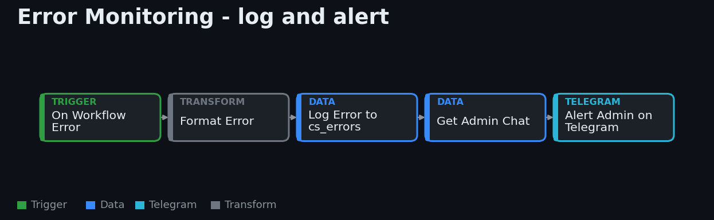

# AI Customer Service

A multi-tenant customer service assistant that runs on Telegram today and is designed to move to WhatsApp Business. One deployment serves many businesses; each business has its own tone, language and verified knowledge.

## Flow

## Workflow canvas

**1. Ingestion and tenant lookup**

**2. Customer, conversation and memory**

**3. AI agent, validation and fallback**

**4. Human handoff, reply and CRM**

## Capabilities

- **Persistent memory** per customer and conversation, with a rolling summary.
- **Verified knowledge only**: hours, prices, services and policies are fetched from a per-business knowledge table.
- **Lead capture**: name, phone, email and requested service are extracted only when the customer actually states them, and tracked as `new`, `contacted` or `qualified`.
- **Human handoff**: the owner is notified first, then the handoff is recorded and the conversation is locked to a human.
- **Booking safety**: the assistant collects booking details but never confirms an appointment on its own.
- **Model fallback**: a secondary model takes over if the primary one fails or is rate limited.
- **Output validation**: every AI response is sanitized (phone numbers, emails, enums, length) before it reaches a customer or the CRM.

## Error monitoring

A separate workflow is attached as the error workflow of the main system. On any failure it:

1. Logs the workflow, execution, failed node and message to an errors table.
2. Sends the admin an alert with a short, actionable fix suggestion (rate limit, credential problem, or inspect the node).

